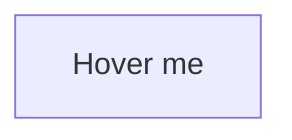

# Mermaid fixture

A diagram whose hover style the remote check does not recognize:



A diagram with a remote image node:

```mermaid
flowchart TD
  pic@{ img: "https://img.example/node.png" }
```
